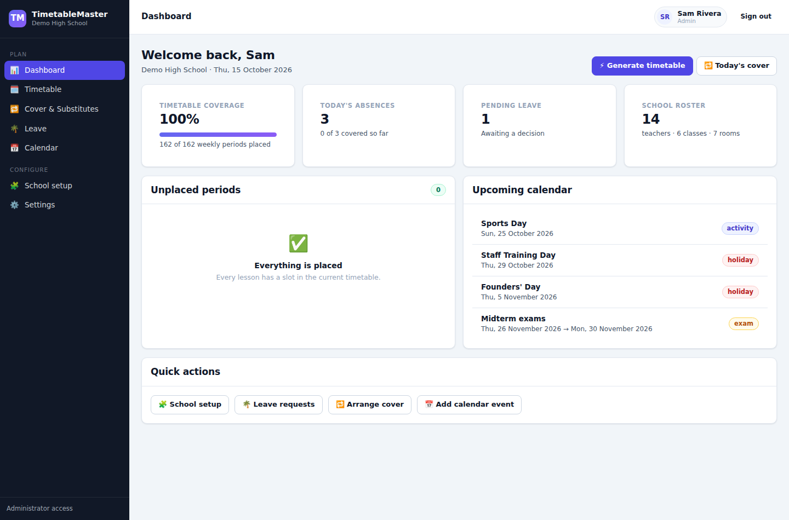
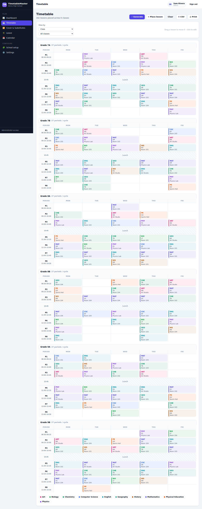
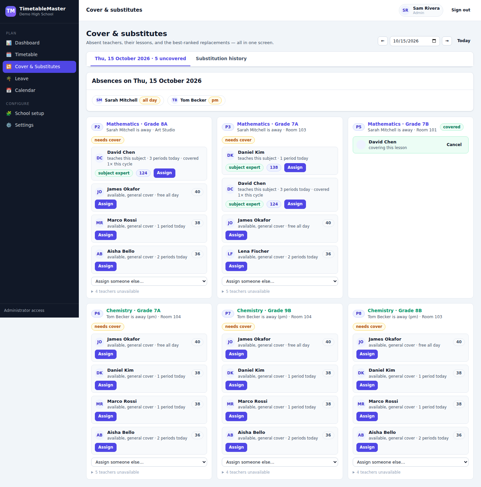
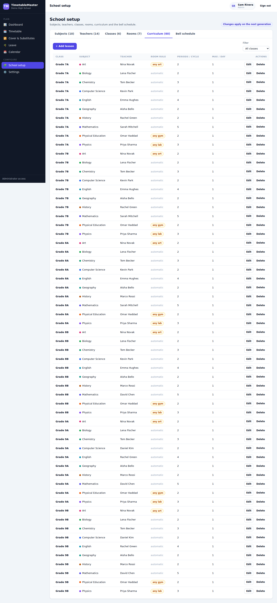
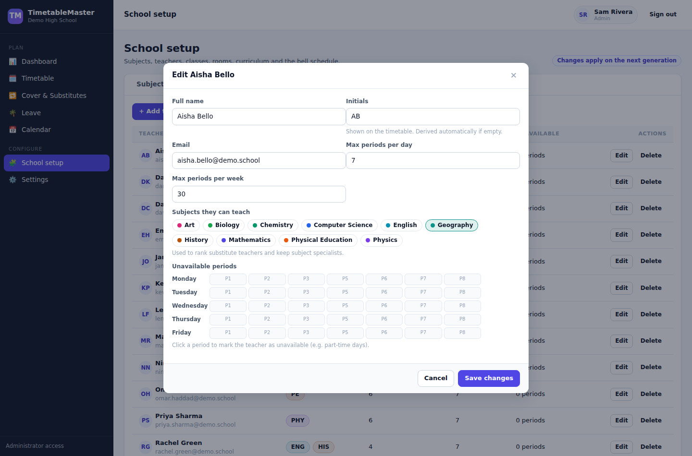
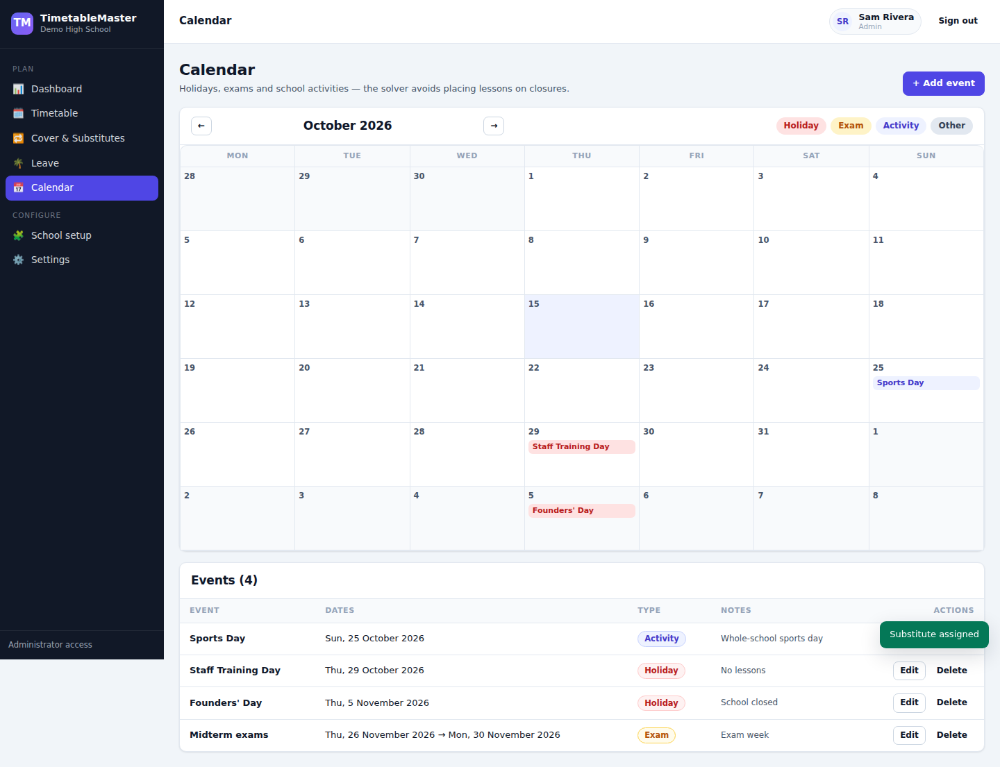

# TimetableMaster

An intelligent timetable platform for schools and universities — automatic timetable
generation, substitute cover, leave management, calendars and role-based access, rebuilt from
scratch in **Rust (Axum + SQLite)** and **JavaScript (React + TypeScript)**.



## Highlights

- **Constraint-based generation engine** — a purpose-built solver (greedy
  most-constrained-first seeding + simulated annealing) that produces clash-free timetables,
  reports exactly what could not be placed and why, and keeps hand-edited lessons pinned.
- **Drag & drop editing** — move any lesson by hand; edits are locked and survive every
  regeneration. Lock/unlock individual periods from the lesson dialog.
- **Cover & substitutes** — record a teacher's absence (or approve their leave) and get a
  ranked list of replacement teachers with the reason each candidate is suggested or blocked
  ("teaches this subject", "teaching another class at this time", "on leave at this time").
- **Leave management** — requests, approvals and an impact preview showing exactly which
  lessons the absence would affect.
- **Multi-tenancy** — every account owns one or more schools; every row is school-scoped.
- **Roles** — `admin`, `scheduler`, `teacher`, `student`, each with their own view of the
  timetable, leave and settings.
- **Two-week cycles** — A/B week timetables, with room, teacher and class constraints applied
  across the whole cycle.
- **Calendar** — holidays, exam periods and school activities; holidays close the school for
  scheduling and cover.
- **CSV, PDF and ICS export** — download a timetable as CSV, a print-ready PDF, or a calendar
  feed (`.ics`) for any class, teacher or room — and print straight from the browser.
- **Shareable read-only timetables** — mint a public link for a class, teacher or room. No sign-in
  required; revoke it any time and the link stops working immediately.
- **Activity log** — every timetable generation, hand-edit, cover assignment, leave decision and
  account change is recorded with who did it and when.
- **Notifications** — optional webhook or email (Knock) delivery when a substitute is assigned or
  leave is requested/decided. Silently no-op when unconfigured.



## Architecture

```
backend/   Rust · Axum 0.8 · sqlx (SQLite) · JWT (HS256) · argon2
  src/solver/       the scheduling engine (pure Rust, unit-tested)
  src/routes/       REST API: auth, setup, timetable, leave, cover, calendar, school, demo,
                    audit, public links, notifications
  src/db.rs         schema + migrations
  src/seed.rs       demo school generator
  src/pdf.rs        dependency-free PDF writer (unit-tested)
  src/ical.rs       iCalendar (.ics) generator (unit-tested)
  src/notifications.rs  webhook / Knock delivery (best-effort)
  src/audit.rs      activity-log writer
frontend/  React 19 · TypeScript · Vite · TanStack Query · React Router
  src/pages/        dashboard, timetable, setup, leave, cover, calendar, settings
  src/components/   app shell and the timetable grid (drag & drop)
  src/api.ts        typed API client
```

The Rust service serves the built SPA from `frontend/dist` when present, so a single process
serves both API and UI. During development, Vite runs on `:5173` and proxies `/api` to `:8080`.

### The scheduling engine

Input is a school: classes, teachers (with weekly/daily caps and unavailable periods), rooms
(with type and capacity), a bell schedule, and a curriculum of *lessons* (class × subject ×
teacher, with periods per cycle, max per day, and an optional fixed/required room type).

**Hard constraints** — never violated:

- a class, a teacher and a room can host at most one lesson per period;
- teachers are only scheduled within their availability;
- lesson `max_per_day` and teacher daily/weekly limits are respected;
- fixed rooms must match; required room types must match and the room must fit the class;
- lessons placed by hand (locked) stay exactly where they are.

**Soft goals** — optimised by simulated annealing:

- no gaps in class and teacher days;
- the same subject spreads across the week instead of clustering;
- teacher load is balanced across days and the timetable is spread across cycle weeks.

Every run returns a report: periods placed, unplaced periods with the dominant reason, move
count and quality scores. Locked lessons are honoured as fixed placements, so "generate" is
always safe to re-run.



## Quick start

Requirements: Rust 1.85+ and Node 20+.

```bash
# 1. API server (http://localhost:8080)
cd backend
cargo run -- --seed-demo        # --seed-demo creates the demo school on first boot

# 2. Frontend
cd frontend
npm install
npm run build                   # or: npm run dev  (Vite dev server on :5173)
```

Then open <http://localhost:8080> — with `--seed-demo` you can sign in with the demo account
(also available via the *Explore the live demo school* button on the login screen):

```
admin@demo.school / demo1234          # administrator
scheduler@demo.school / demo1234      # timetable scheduler
teacher login: e.g. david.chen@demo.school / demo1234
student@demo.school / demo1234        # student in Grade 7A
```

Environment variables:

| Variable | Purpose |
| --- | --- |
| `PORT` | HTTP port (default `8080`) |
| `TIMETABLE_DB` | SQLite path (default `data/timetable.db`) |
| `TIMETABLE_JWT_SECRET` | JWT signing secret (a random one is generated under `data/` on first run) |
| `NOTIFY_WEBHOOK_URL` | Optional: POST notification JSON to any webhook |
| `KNOCK_API_KEY` | Optional: deliver notifications (email/in-app) via [Knock](https://knock.app) |

Notifications are entirely optional — with neither variable set the app runs normally and simply
skips them.

### Tests

```bash
cd backend && cargo test        # solver unit tests: feasibility, clashes, limits,
                                # room rules, fixed placements, 2-week cycles, determinism
```

## API overview

| Method | Path | Purpose |
| --- | --- | --- |
| `POST` | `/api/auth/signup` · `/api/auth/login` · `GET /api/auth/me` | accounts and sessions |
| `GET/PUT` | `/api/school` | school name and cycle length |
| `GET/POST/PUT/DELETE` | `/api/subjects` `/api/teachers` `/api/classes` `/api/rooms` `/api/lessons` | curriculum setup |
| `PUT` | `/api/bell-schedule` | period times per day |
| `GET` | `/api/setup/all` | everything the setup screens need in one call |
| `POST` | `/api/generate` | run the solver (`time_limit_ms`, `seed`, `weights`) |
| `GET` | `/api/timetable` | slots + placed entries |
| `POST/PUT/DELETE` | `/api/timetable/entries[/{id}]` | place, move, lock and remove lessons |
| `POST` | `/api/timetable/clear` | empty the timetable |
| `GET` | `/api/export/timetable.csv` · `.pdf` · `.ics` | CSV / PDF / calendar export |
| `GET/POST` | `/api/leave`, `/api/leave/{id}/decide`, `/cancel`, `/impact` | leave workflow |
| `GET` | `/api/cover?date=` | absences, lessons and ranked substitute candidates |
| `POST` / `DELETE` | `/api/cover/assign`, `/api/cover/{id}` | assign / cancel a substitute |
| `GET/POST/PUT/DELETE` | `/api/calendar[/{id}]` | school calendar |
| `GET/POST/PUT/DELETE` | `/api/users[/{id}]` | staff accounts |
| `GET` | `/api/dashboard` | coverage stats, gaps, today's absences, upcoming events |
| `GET` | `/api/audit` | activity log (staff) |
| `GET/POST` | `/api/public-links`, `DELETE /api/public-links/{id}` | shareable read-only links (staff) |
| `GET` | `/api/public/timetable/{token}` | anonymous read of a shared timetable |
| `GET/POST` | `/api/notifications/status`, `/api/notifications/test` | notification config and test send |
| `POST` | `/api/demo/seed` · `/api/demo/reset` | public demo workspace |

All endpoints are school-scoped from the JWT; write endpoints require the `admin` or
`scheduler` role (teachers may request their own leave, students are read-only).

## Screenshots

| Curriculum setup | Teacher availability | Calendar |
| --- | --- | --- |
|  |  |  |

## Notes and roadmap

- Passwords are argon2 hashes; JWTs are HS256-signed with a per-installation secret.
- The demo workspace can be rebuilt any time from *Settings → Demo workspace*.
- Exports and share links target the class, teacher or room you are currently viewing, and honour
  the selected cycle week.
- Still open: multi-teacher/team-taught lessons, subject-vs-time-of-day preferences, and an
  iCal subscription feed (the one-off `.ics` export is already in place).
